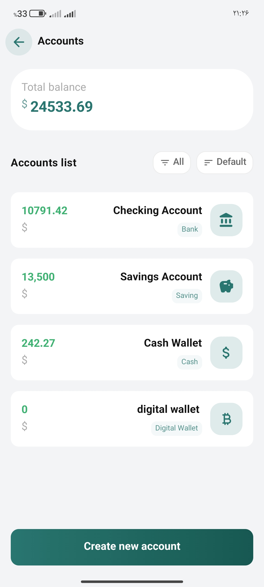
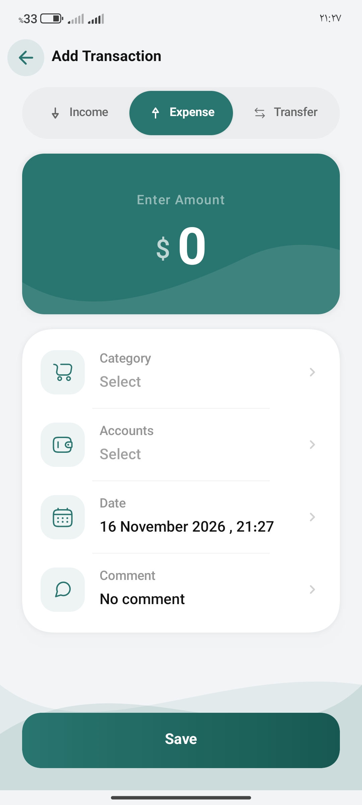
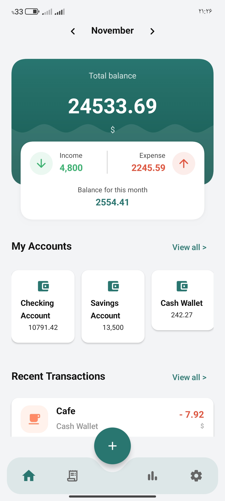
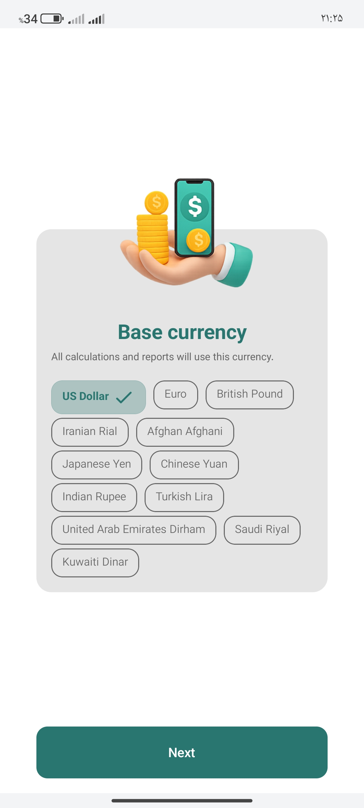
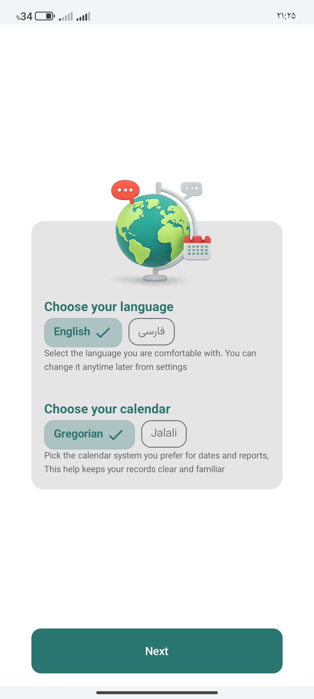
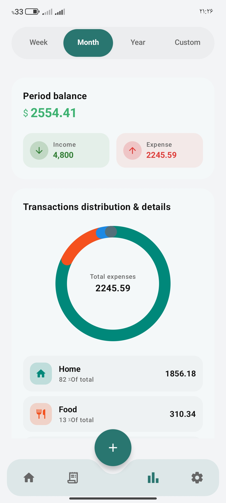
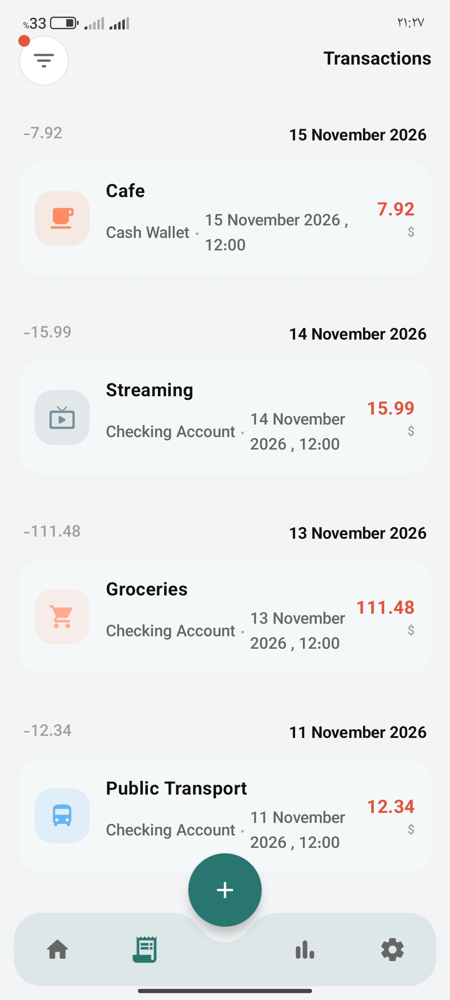

# HesabHam — Personal Expense Tracker

<p align="center">
  <strong>A modern Android application for managing personal finances.</strong>
</p>

<p align="center">
  Built with Kotlin, Jetpack Compose, and Clean Architecture.
</p>

---

## Overview

**HesabHam** is a personal finance management Android application designed to help users track their income and expenses, manage multiple financial accounts, record money transfers, and understand their spending habits through financial reports.

The application provides a structured way to organize financial activities while supporting different currencies, languages, and calendar systems.

HesabHam is built using modern Android development technologies and follows Clean Architecture principles to maintain a clear separation between business logic, data management, and the user interface.

This project was developed as a portfolio project to demonstrate practical Android development skills, architectural design, and implementation of a feature-rich application.

## Screenshots

<p align="center">
  
  
  
  
  
  
  
</p>


*Application screenshots will be added here.*

## Features

### Account Management
- Create and manage multiple financial accounts.
- Support different account types.
- Set an initial balance when creating an account.
- View individual account balances.
- Monitor the total balance across active accounts.
- Archive and restore accounts without deleting their transaction history.

### Transaction Management
- Record income and expense transactions.
- Edit and delete existing transactions.
- Assign categories to transactions.
- Add optional notes and select transaction dates.
- View transactions grouped by date.
- Keep track of initial account balances.

### Money Transfers
- Transfer money between different accounts.
- Automatically create corresponding outgoing and incoming transactions.
- Keep transfer records connected to their related transactions.
- Update account balances as part of the transfer operation.

### Category Management
- Organize transactions using predefined and custom categories.
- Support parent categories and subcategories.
- Separate income and expense categories.
- Edit and archive categories.
- Restore archived categories when needed.
- Load predefined categories from a JSON asset.

### Dashboard
- View the total balance of active accounts.
- Monitor monthly income and expenses.
- Access recent transactions.
- Get an overview of financial activity.

### Financial Reports
- View income and expense summaries.
- Analyze expenses by category.
- Explore category-based spending distribution.
- View financial trends over different time ranges.
- Display daily average spending.
- Identify top income and expense transactions.

### Localization and Customization
- Persian and English language support.
- Jalali and Gregorian calendar support.
- Light and dark themes.
- Configurable display currency.
- Persistent application preferences.

### Onboarding
- Guided initial application setup.
- Configure language and calendar preferences.
- Create the first financial account.
- Set the initial account balance.
- Select the preferred currency.

---

## Tech Stack

The application is developed using modern Android development tools and libraries.

| Technology | Purpose |
|---|---|
| **Kotlin 2.1.20** | Primary programming language |
| **Jetpack Compose** | Declarative UI toolkit |
| **Material 3** | Modern Android UI components |
| **Kotlin Coroutines** | Asynchronous programming |
| **Kotlin Flow** | Reactive data streams |
| **Room 2.8.4** | Local database |
| **DataStore Preferences 1.1.7** | Persistent application settings |
| **Koin 3.5.6** | Dependency injection |
| **Navigation Compose 2.9.7** | Navigation between screens |
| **KSP** | Kotlin Symbol Processing |
| **Lottie Compose 6.6.2** | UI animations |
| **ThreeTenABP 1.4.7** | Date and time handling |
| **PersianDate 1.7.1** | Persian calendar support |
| **Snapper 0.3.0** | Scroll snapping for wheel pickers |
| **Jetpack Lifecycle** | Lifecycle-aware components |

### Build Tools

- Android Gradle Plugin: `8.6.1`
- Gradle: `8.14`
- Kotlin: `2.1.20`
- Compose BOM: `2025.06.01`
- KSP: `2.1.20-2.0.0`

---

## Architecture

HesabHam follows **Clean Architecture** principles, separating the application into independent layers with clearly defined responsibilities.

The main goal is to keep business logic independent of Android framework details, database implementation, and UI components.

### Architecture Layers

```text
af.amir.hesabham
│
├── data
│   ├── db
│   │   ├── dao
│   │   ├── entity
│   │   └── mapper
│   │
│   ├── preference
│   └── repo
│
├── domain
│   ├── common
│   ├── model
│   ├── provider
│   ├── repo
│   ├── usecase
│   └── util
│
├── framework
│   └── datetime
│
├── presentation
│   ├── accounts
│   ├── add_transaction
│   ├── core
│   ├── home
│   ├── navigation
│   └── onboarding
│
└── di
```

### Domain Layer

Contains the core business logic and application rules.

Responsibilities include:

- Domain models and value objects.
- Repository interfaces.
- Use cases.
- Business-related abstractions.
- Domain-level utilities.

The Domain layer does not depend on Room entities or UI models.

### Data Layer

Responsible for data storage and retrieval.

Responsibilities include:

- Room database configuration.
- DAOs and database entities.
- Repository implementations.
- Data mappers.
- Persistent settings implementation.
- Loading predefined data from application assets.

Room entities are mapped to domain models so that database implementation details do not leak into the business layer.

### Presentation Layer

Responsible for displaying application data and handling user interactions.

Responsibilities include:

- Jetpack Compose screens and components.
- ViewModels.
- UI state and user actions.
- UI-specific models.
- Navigation.
- UI-related mapping and formatting.

The presentation layer uses ViewModels to expose screen state and coordinate user actions with domain use cases.

### Framework Layer

Contains platform-specific implementations of application abstractions.

For example, the date and calendar functionality is separated into a dedicated calendar engine, allowing the application to work with different calendar systems.

### Dependency Injection

Koin is used to provide dependencies and connect the different application layers.

---

## Key Technical Implementations

### 1. Unidirectional UI State Management

The presentation layer follows a unidirectional data flow approach.

- ViewModels expose observable UI state.
- User interactions are represented as actions.
- The ViewModel processes actions and updates the screen state.
- One-time UI events are handled separately from persistent screen state.

This approach helps keep UI behavior predictable and makes screen logic easier to maintain.

### 2. Use Case-Based Business Logic

Business operations are organized into dedicated use cases rather than being implemented directly inside UI components or repositories.

Examples include:

- `CreateAccountUseCase`
- `RecordTransactionUseCase`
- `RecordTransferTransactionUseCase`
- `UpdateTransactionUseCase`
- `ObserveMonthlySummaryUseCase`
- `ObserveTopTransactionsUseCase`

This keeps business rules focused and gives application operations clear responsibilities.

### 3. Atomic Money Transfers

A money transfer affects two accounts and creates two related transactions:

- An outgoing transaction from the source account.
- An incoming transaction for the destination account.

These related database operations are executed within a Room database transaction to ensure that the transfer is handled atomically.

This prevents partially completed transfer operations from being persisted.

### 4. Domain and Database Model Separation

The application uses separate models for business logic and database persistence.

For example:

- `Account` is a domain model.
- `AccountEntity` represents its database counterpart.

Mappers are responsible for converting between these representations.

This reduces coupling between the Domain and Data layers.

### 5. Calendar Abstraction

The application supports both Jalali and Gregorian calendar systems.

Calendar-related operations are organized behind a calendar engine abstraction, keeping calendar implementation details separate from the rest of the application.

### 6. Reactive Data Observation

Kotlin Flow is used to observe data changes and expose reactive streams from the data layer to the presentation layer.

This allows screens to react to changes in transactions, accounts, and financial summaries.

### 7. Persistent Application Settings

DataStore Preferences is used to persist application preferences, including:

- Selected language.
- Calendar system.
- Display currency.
- Theme preference.

---

## Project Structure

The project currently consists of a single Android application module.

```text
Hesabham/
│
├── app/
│   ├── src/
│   │   ├── main/
│   │   │   ├── assets/
│   │   │   │   ├── categories.json
│   │   │   │   └── currencies.json
│   │   │   │
│   │   │   ├── java/af/amir/hesabham/
│   │   │   │   ├── data/
│   │   │   │   ├── di/
│   │   │   │   ├── domain/
│   │   │   │   ├── framework/
│   │   │   │   ├── presentation/
│   │   │   │   ├── AppConfigState.kt
│   │   │   │   ├── AppConfigViewModel.kt
│   │   │   │   ├── Application.kt
│   │   │   └── res/
│   │   │
│   │   ├── test/
│   │   └── androidTest/
│   │
│   ├── build.gradle.kts
│   └── proguard-rules.pro
│
├── gradle/
│   ├── libs.versions.toml
│   └── wrapper/
│
├── build.gradle.kts
├── gradle.properties
├── gradlew
├── gradlew.bat
└── settings.gradle.kts
```

---

## Getting Started

### Requirements

To build and run the project, you need:

- Android Studio.
- JDK 17 or newer.
- Android SDK.
- An Android device or emulator running Android 7.0 (API 24) or newer.

### Clone the Repository

```bash
git clone https://github.com/amirr-sharifi/HesabHam-jetpackCompose
```


### Open the Project

1. Open Android Studio.
2. Select **Open**.
3. Choose the cloned project directory.
4. Allow Gradle to sync and download the required dependencies.
5. Run the application on an emulator or physical Android device.

### Build the Debug APK

You can build the debug APK using the Gradle wrapper:

```bash
./gradlew assembleDebug
```

On Windows:

```bash
gradlew.bat assembleDebug
```

The generated APK will be available at:

```text
app/build/outputs/apk/debug/
```

### Build the Release APK

To generate a release build:

```bash
./gradlew assembleRelease
```

The generated release APK will be located at:

```text
app/build/outputs/apk/release/
```

**Note:** The release build must be signed before it can be installed as a normal release application. You can generate a signed APK using Android Studio's **Build > Generate Signed Bundle / APK** option.

Signing credentials and keystore files should never be committed to the repository.

---

## Application Information

| Property | Value |
|---|---|
| Application Name | HesabHam |
| Application ID | `af.amir.hesabham` |
| Version Name | `1.0` |
| Version Code | `1` |
| Minimum SDK | `24` |
| Target SDK | `34` |
| Compile SDK | `35` |
| Gradle Modules | `:app` |

---

## Future Improvements

Potential areas for future development include:

- Additional automated unit and integration tests.
- Further improvements to reporting and financial insights.
- Additional calendar system support.
- Continued UI and accessibility improvements.

---

## Author

**Amir Sharifi**

Self-taught Android Developer focused on Kotlin and modern Android development.

- **GitHub:** [@amirr-sharifi](https://github.com/amirr-sharifi)
- **LinkedIn:** [Amir Sharifi](https://www.linkedin.com/in/amirr-sharifi/)


---

<p align="center">
  <strong>HesabHam</strong>
  <br />
  Personal finance management, built with modern Android development practices.
</p>
